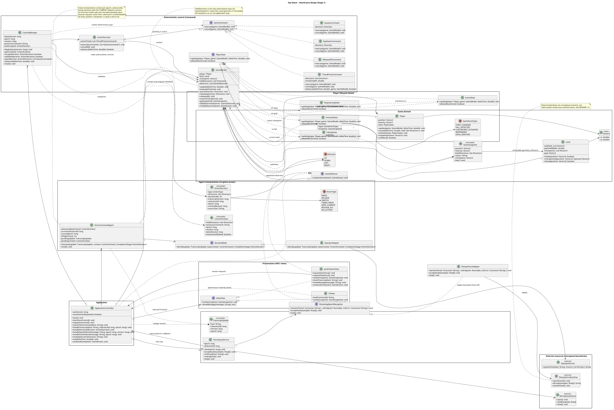

# Stage 2 Implemented Design Patterns

The five patterns proposed in Stage 1 remain implemented: **MVC, Command, Adapter, Observer and State**. Each solves a concrete problem in the shared Java application. The [change record](design-changes.md) explains implementation refinements; no pattern has been replaced and no repeated use is counted as an additional pattern.

## Current implementation UML

The current class diagram is a UMLet-exported SVG. It shows the shared GUI/CLI architecture, control epoch/version/revision fields, `ActionExecutor.activeTimed`, `TimedPressCommand.remainingMs`, structured movement memory and the external SemIf boundary. Its historical “Stage 1 revised” title identifies the design lineage; the classes and key operations describe the current implementation. Concrete classes inherit interface operations, so inherited methods need not be repeated in each box.

The [use-case diagram](uml/use-case-diagram.svg) and affected sequences are also current: [SD01 voice](uml/sequence-diagrams/sd01-gui-voice-command.svg), [SD02 CLI](uml/sequence-diagrams/sd02-cli-text-command.svg), [SD03 context/repeat](uml/sequence-diagrams/sd03-contextual-command.svg), [SD04 correction/timed actions](uml/sequence-diagrams/sd04-live-correction.svg), and [SD05 start recovery](uml/sequence-diagrams/sd05-fall-recovery.svg). Original diagram sources/exports remain in Git history; they are not claimed to exist as current repository files.

## 1. MVC — shared behavior for two frontends

**Problem:** JavaFX and the terminal need different rendering/input mechanisms while exposing the same game and agent functionality. Duplicating movement, interpretation or recovery in the views would make behavior diverge.

| Participant and source | Role and actual methods |
|---|---|
| [GameModel](../src/main/java/com/sayswear/game/GameModel.java), [Player](../src/main/java/com/sayswear/game/Player.java), [Level](../src/main/java/com/sayswear/game/Level.java) | Model: authoritative held inputs, player state and geometry. `update()`, `getSnapshot()`, `evaluatePosition()`, `move()`, `isSafe()`, `isGoal()`. |
| [ApplicationController](../src/main/java/com/sayswear/app/ApplicationController.java) | Controller: serializes input, decision acceptance, simulation and cleanup. `submitTextCommand()`, `handleTranscript()`, `handleDecision()`, `advance()`, `onGameEvent()`. |
| [GameView](../src/main/java/com/sayswear/view/GameView.java) | Presentation contract: `render()`, `showTranscript()`, `showVoiceStatus()`, `showMessage()`. |
| [JavaFxGameView](../src/main/java/com/sayswear/view/JavaFxGameView.java), [CliView](../src/main/java/com/sayswear/view/CliView.java) | Views: draw snapshots and present feedback. GUI `submitTypedCommand()`/`requestStartVoice()` route intent to the controller; CLI `readCommand()` returns text for the launcher to submit. |
| [Main](../src/main/java/com/sayswear/app/Main.java) | Composition: `compose()` builds the shared core for either frontend; `runCli()` handles terminal session commands. |

**How it follows the pattern:** a GUI text submission or CLI instruction reaches the same controller and agent. Accepted commands mutate `GameModel`; immutable snapshots reach the selected view. JavaFX scheduling and JLine terminal redraw remain presentation concerns. Neither renderer advances player physics or interprets direction language.

**Why useful / without it:** fixes to collision, correction or repeat behavior apply to both frontends. Without this separation, consistent GUI/CLI tests and alternate presentation would require changes to duplicated logic.

**Stage 1 comparison:** MVC is retained. D03 makes `GameView` inherit the observer contract, D04 adds GUI typed input, and D06/D19 refine rendering. These change presentation plumbing rather than replacing MVC. Features: F01–F04 and shared presentation of F05–F10.

## 2. Command — cancellable deterministic movement

**Problem:** a new correction, fall or timeout must interrupt old timed movement without a delayed release affecting a newer command. AI output must not directly mutate game state.

| Participant and source | Role and actual methods |
|---|---|
| [GameCommand](../src/main/java/com/sayswear/control/GameCommand.java) | Command interface: `execute(GameModel)` and `cancel(GameModel)`. |
| [KeyDownCommand](../src/main/java/com/sayswear/control/KeyDownCommand.java), [KeyUpCommand](../src/main/java/com/sayswear/control/KeyUpCommand.java) | Concrete commands: press or release one direction through `execute()`; cancellation never reintroduces an already released input. |
| [TimedPressCommand](../src/main/java/com/sayswear/control/TimedPressCommand.java) | Concrete timed command: `execute()`, `advance()`, `cancel()` own one compatible direction set and its remaining duration. |
| [ReleaseAllCommand](../src/main/java/com/sayswear/control/ReleaseAllCommand.java) | Concrete neutralizing command: `execute()` clears held controls. |
| [ControlManager](../src/main/java/com/sayswear/control/ControlManager.java) | Client/planner: `accept()`, `validate()` and `plan()` translate a fresh semantic decision into command objects. |
| [ActionExecutor](../src/main/java/com/sayswear/control/ActionExecutor.java) | Invoker: `execute()`, `cancelAll()`, `advance()` own the active timed-command list and rollback partial failures. |
| [GameModel](../src/main/java/com/sayswear/game/GameModel.java) | Receiver: `press()`, `release()`, `releaseAll()` update authoritative inputs. |

**How it follows the pattern:** a `SWITCH LEFT` proposal becomes release-right and press-left commands. The manager computes the desired set, cancels old timed work, then the executor applies the replacement on the application loop. Timer expiry is advanced on that same loop; there is no detached delayed-release callback. A `REPEAT_LAST` creates fresh commands from remembered semantics, never reuses an old command object or request identity.

**Why useful / without it:** cancellation, timed behavior and failure rollback are testable without an LLM. Without explicit command objects, these responsibilities would be spread across interpretation callbacks and game mutation code, making stale timer effects harder to prevent.

**Stage 1 comparison:** the planned pattern/classes remain. D10 specifies elapsed-time advancement; D11 centralizes invalidation; D18 adds fresh replay through the existing command mechanism. No general undo/history system is claimed. Features: F04–F10 where decisions, interruption or recovery require commands.

## 3. Adapter — isolate speech and decision providers

**Problem:** native sherpa-onnx APIs and SemIf's local HTTP/logits service have different input, lifetime and failure conventions. Those details must not spread into game/control logic.

| Participant and source | Role and actual methods |
|---|---|
| [StreamingSpeechRecognizer](../src/main/java/com/sayswear/voice/StreamingSpeechRecognizer.java) | Target interface: `start(onPartial, onEndpoint, onError)`, `acceptAudio()`, `stop()`, `close()`. |
| [SherpaOnnxAdapter](../src/main/java/com/sayswear/voice/SherpaOnnxAdapter.java) | Adapter: creates the native online recognizer/stream, feeds audio, converts partials/endpoints and releases native resources. `start()`, `acceptAudio()`, `stop()`. |
| sherpa-onnx `OnlineRecognizer` / `OnlineStream` | External adaptees, used through the adapter's typed Java API. |
| [DecisionModel](../src/main/java/com/sayswear/agent/DecisionModel.java) | Target interface: asynchronous `decide(TranscriptUpdate, ControlContext)` returning `ActionDecision`. |
| [OpenJevAdapter](../src/main/java/com/sayswear/agent/OpenJevAdapter.java) | Adapter: `decide()` builds a control-only request; `parseResponse()` checks backend/model and maps an allowed label to semantic output. |
| [SemIf bridge](../tools/semif/server.py) and pinned Qwen3.5 4B | External adaptee boundary: `/decide` uses genuine SemIf logits scoring and returns a bounded choice. The bridge is supporting model-runtime code; the application remains Java. |
| [VoiceInputService](../src/main/java/com/sayswear/voice/VoiceInputService.java), [VoiceCommandAgent](../src/main/java/com/sayswear/agent/VoiceCommandAgent.java) | Clients depend on the target interfaces, allowing controlled substitutes in tests. |

**How it follows the pattern:** speech callbacks become provider-independent transcripts; HTTP/scoring output becomes a provider-independent semantic decision. Neither adapter calls `GameModel.press()` or performs route planning. The optional [DemoDecisionModel](../src/main/java/com/sayswear/agent/DemoDecisionModel.java) implements the same target for explicitly labeled offline use; it is not the real LLM integration or an automatic fallback.

**Why useful / without it:** native deployment and provider protocol changes can be isolated and tested. Without adapters, the controller would need native recognition and HTTP/schema details, and testing failures would require live hardware/services.

**Stage 1 comparison:** the same two target interfaces/adapters remain. D01 corrects the provider identity to SemIf/Qwen, D13/D16 refine bounded readouts, and D14 specifies native deployment. These are adaptee/integration changes, not a new counted pattern. Features: F02–F08.

## 4. Observer — lifecycle cleanup and presentation

**Problem:** a fall or goal must notify both cleanup/control coordination and presentation without the game depending on a particular GUI or terminal class.

| Participant and source | Role and actual methods |
|---|---|
| [GameModel](../src/main/java/com/sayswear/game/GameModel.java) | Subject: `addObserver()`, `removeObserver()`, `notifyObservers()` publish domain events synchronously. |
| [GameObserver](../src/main/java/com/sayswear/game/GameObserver.java) | Observer interface: `onGameEvent(GameEvent)`. |
| [GameEvent](../src/main/java/com/sayswear/game/GameEvent.java), [GameEventType](../src/main/java/com/sayswear/game/GameEventType.java) | Event value/type: state change, fall, respawn and goal, with an immutable snapshot. |
| [ApplicationController](../src/main/java/com/sayswear/app/ApplicationController.java) | Concrete observer: `start()` registers cleanup first; `onGameEvent()` invalidates controls/agent work and coordinates voice recovery. |
| [GameView](../src/main/java/com/sayswear/view/GameView.java), [JavaFxGameView](../src/main/java/com/sayswear/view/JavaFxGameView.java), [CliView](../src/main/java/com/sayswear/view/CliView.java) | Presentation observers: inherited/default or overridden `onGameEvent()` renders snapshots and lifecycle messages; CLI throttles ordinary refresh while preserving lifecycle output. |

**How it follows the pattern:** `GameModel.evaluatePosition()` publishes `FALL_DETECTED`; the controller cancels old work, and the selected view presents the fall. Respawn/goal notifications follow the same contract. The game refers to `GameObserver`, not frontend implementations. Notification uses a copied subscriber list and isolates an observer's runtime exception so other subscribers still receive the event.

**Why useful / without it:** lifecycle cleanup and rendering can evolve independently. Without observer notification, the game would need direct controller/view calls or duplicated polling logic. Synchronous ordering here is deliberate, allowing cleanup before presentation observers.

**Stage 1 comparison:** the planned subject/observers remain. D03 centralizes the view contract, D08 adds removal/exception isolation, and D17 removes checkpoint events as part of the documented gameplay change. Features: F01/F10 and lifecycle control cleanup supporting F02/F09.

## 5. State — explicit player lifecycle

**Problem:** movement, recovery and goal completion need different behavior. Repeating lifecycle conditionals across game updates and frontends would make it easy to move during recovery or after finishing.

| Participant and source | Role and actual methods |
|---|---|
| [Player](../src/main/java/com/sayswear/game/Player.java) | Context: stores `PlayerState`; `update()` delegates, `setState()` changes behavior and stops velocity when movement is disallowed. |
| [PlayerState](../src/main/java/com/sayswear/game/PlayerState.java) | State interface: `update(player, game, deltaTime)`, `allowsMovement()`, `status()`. |
| [ActiveState](../src/main/java/com/sayswear/game/ActiveState.java) | Concrete active state: subdivides movement and evaluates position in `update()`; permits movement. |
| [FallingState](../src/main/java/com/sayswear/game/FallingState.java) | Concrete falling state: disallows movement; its next `update()` calls `GameModel.resetToStart()`. |
| [RespawningState](../src/main/java/com/sayswear/game/RespawningState.java) | Concrete recovery state: next `update()` restores `ActiveState` and publishes `RESPAWNED`. |
| [FinishedState](../src/main/java/com/sayswear/game/FinishedState.java) | Concrete completed state: disallows movement and keeps velocity zero in `update()`. |
| [GameModel](../src/main/java/com/sayswear/game/GameModel.java) | Transition collaborator: `evaluatePosition()`, `resetToStart()`, `restart()` select lifecycle transitions. |

**How it follows the pattern:** the normal path is Active → Falling → Respawning → Active, or Active → Finished. These are different state objects with behavior, not only an enum with scattered branches. `PlayerStatus` is the immutable presentation value; it does not replace polymorphic state execution.

**Why useful / without it:** each lifecycle's update policy can be tested in isolation, and frontends receive the same status. Without State, movement and recovery rules would become repeated conditional checks and could disagree across paths.

**Stage 1 comparison:** all four planned states remain. D02 adds a typed status enum; D17 changes the recovery destination from a saved checkpoint to the level start. The State pattern still implements the same lifecycle separation. Features: F01/F10, with lifecycle gating used by F09.

## Verification boundary

The saved ordinary Java suite exercises game states, observer subscription, cancellation/rollback, freshness, both presentation contracts and provider boundaries. Recorded real-model and native-ASR checks are separate from controlled tests. The user has given general gameplay acceptance; specific microphone coverage and the updated default-budget GPU gate remain unverified. See [validation](validation.md) for dates, commands and limitations, and the [feature mapping](feature-implementation-mapping.md) for pending video references.
